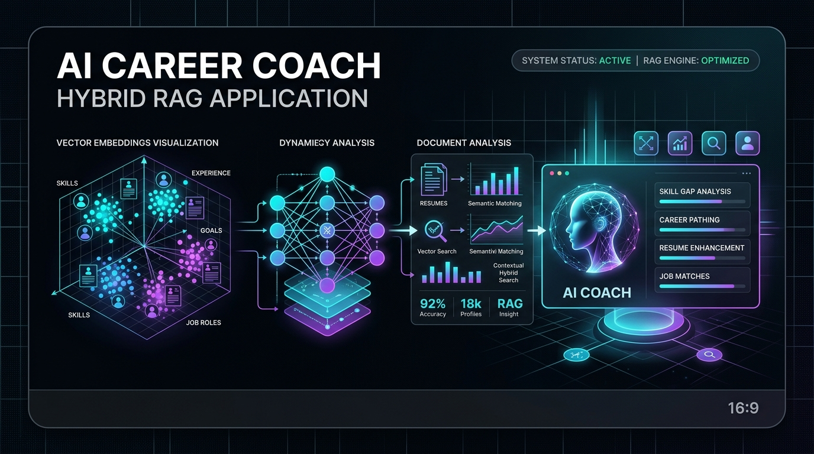
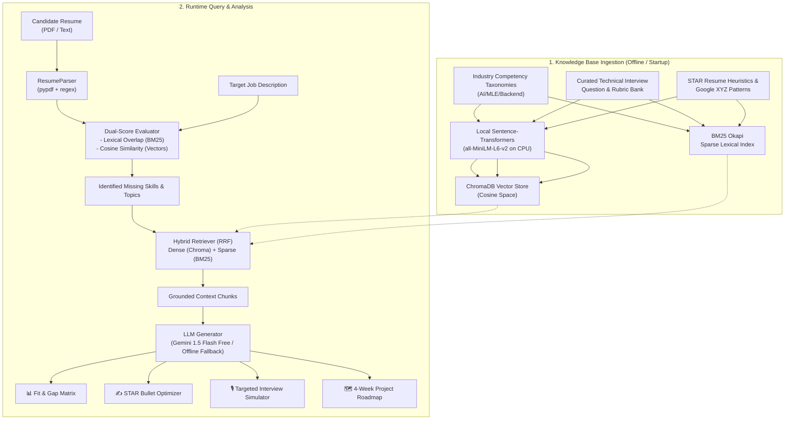

# 🎯 AI Career Coach & Interview Copilot (Hybrid RAG)

<p align="center">
  
</p>

[](https://www.python.org/)
[](https://streamlit.io/)
[](https://www.trychroma.com/)
[](LICENSE)
[]()

> A production-grade **Retrieval-Augmented Generation (RAG)** application designed to solve real-world career transitions and technical interview preparation. Combines **Dense Vector Embeddings** with **BM25 Lexical Keyword Search** via **Reciprocal Rank Fusion (RRF)** to deliver grounded skill-gap analysis, STAR resume rewriting, and mock technical interview simulations.

---

## 🌟 Key Features

1. **Multi-Modal Document Parsing**:
   - Parses native PDF and plaintext resumes with automatic section segmentation (Skills, Experience, Projects, Education).
2. **Hybrid RAG Retrieval Engine**:
   - Merges **Dense Vector Semantic Search** (`sentence-transformers/all-MiniLM-L6-v2` running locally on CPU) with **BM25 Okapi Sparse Search** for exact technical keywords.
   - Combines rankings using **Reciprocal Rank Fusion (RRF)** to eliminate false negatives.
3. **Dual-Metric Fit Evaluation**:
   - Calculates both exact lexical keyword overlap (ATS style) and deep semantic conceptual alignment (vector cosine similarity).
4. **STAR Method Resume Optimizer**:
   - Grounded in industry best practices, automatically converts task-oriented bullet points into quantified accomplishments (*Google XYZ Formula: Accomplished X, measured by Y, by doing Z*).
5. **Targeted Technical Interview Simulator**:
   - Dynamically pulls vetted technical interview questions targeting the candidate's exact skill gaps for the specific job posting, complete with an interactive answer grader.
6. **Personalized 4-Week Career Roadmap**:
   - Generates a project-driven curriculum prioritizing GitHub portfolio builds and weekly interview checkpoints.
7. **100% Free & Zero-Credit-Card Architecture**:
   - Runs locally out-of-the-box. Uses Google Gemini's free tier (no credit card needed) and local embeddings/vector store. Features offline smart heuristics if no API key is provided.

---

## 🏗️ System Architecture



---

## 🛠️ Technology Stack

| Layer | Technology | Rationale & Trade-offs |
|---|---|---|
| **Frontend UI** | Streamlit | Rapid prototyping, interactive widgets, zero HTML/CSS overhead |
| **Embeddings** | `sentence-transformers` (`all-MiniLM-L6-v2`) | Runs 100% locally on CPU, 384 dimensions, zero API cost, sub-10ms inference |
| **Vector Database** | ChromaDB | Lightweight, persistent SQLite-backed vector storage, zero Docker or cloud setup |
| **Sparse Retrieval** | `rank-bm25` (Okapi BM25) | Critical for exact technical keyword matching (e.g. `Docker`, `PyTorch`, `CUDA`) |
| **Rank Merging** | Reciprocal Rank Fusion (RRF) | Balances different score distributions between cosine similarity and BM25 scores |
| **LLM Provider** | Google Gemini 1.5 Flash | 100% free tier at Google AI Studio with **NO credit card required**, fast TTFT |

---

## 🚀 Quick Start Guide

### 1. Clone & Set Up Environment
```bash
# Clone the repository
git clone https://github.com/SeifMohamed19/ai-career-coach-rag.git
cd ai-career-coach-rag

# Create and activate a virtual environment
python -m venv venv
# On Windows:
.\venv\Scripts\activate
# On Linux/macOS:
source venv/bin/activate

# Install dependencies
pip install -r requirements.txt
```

### 2. Configure Environment (Optional Free API Key)
Copy `.env.example` to `.env`:
```bash
copy .env.example .env
```
To enable live Gemini generation:
1. Visit [Google AI Studio](https://aistudio.google.com/) and create a free API key using your standard Google account (**no credit card required**).
2. Paste the key into `.env`:
   ```env
   GEMINI_API_KEY=your_actual_key_here
   ```
*(Note: If you leave the key blank, the application will automatically run in **Offline Smart Heuristic Mode**, allowing complete testing without internet or keys).*

### 3. Launch the Application
```bash
streamlit run app.py
```
Open your browser at `http://localhost:8501`. Click **"Load Sample Profile & Job"** in the sidebar to test immediately with one click!

---

## 🎓 Technical Interview Defense Guide

When discussing this project in technical interviews, be ready to answer these core engineering questions:

### Q1: *"Why use RAG for career coaching when a resume and job description easily fit in an LLM context window?"*
> **Answer**:  
> "A simple prompt with just a resume and job description is a closed-world comparison. The LLM can only do a basic lexical diff and often hallucinates arbitrary advice.  
> In our system, RAG grounds the analysis in an external curated knowledge base:  
> 1. Real industry competency standards (separating must-haves from nice-to-haves).  
> 2. A verified bank of real technical interview questions indexed by topic.  
> 3. Standardized STAR impact heuristics.  
> This allows the model to give verified, domain-calibrated feedback rather than generic advice, and reduces token consumption per interaction."

### Q2: *"Why combine BM25 and Dense Vector search (Hybrid Search)?"*
> **Answer**:  
> "Dense vector embeddings excel at semantic nuance (e.g., matching *'inference acceleration'* with *'low latency'*), but they struggle with exact technical keywords, acronyms, and version numbers (e.g., *'CUDA 11.8'*, *'ONNX'*, *'DDP'*).  
> BM25 is an exact lexical algorithm that ensures specific tool names are never missed. By combining both through Reciprocal Rank Fusion (RRF), we achieve high recall for semantic concepts without sacrificing precision on exact technologies."

### Q3: *"What is Reciprocal Rank Fusion (RRF) and why not just add the scores?"*
> **Answer**:  
> "Dense similarity scores (cosine range 0 to 1) and BM25 scores (unbounded positive float values) have completely different mathematical distributions. Simply adding them or multiplying them introduces calibration distortion.  
> RRF bypasses score normalization by working purely with **ranks**:  
> $$RRF(d) = \sum_{m \in M} \frac{w_m}{k + \text{rank}_m(d)}$$  
> A document ranked #1 in BM25 and #2 in vector search receives a high combined score without needing arbitrary score thresholding."

---

## 📂 Project Structure

```
RAGProject/
├── app.py                        # Streamlit web dashboard
├── test_pipeline.py              # Automated pipeline test runner
├── requirements.txt              # Pinned production dependencies
├── .env.example                  # Environment configuration template
├── .gitignore                    # Version control excludes
│
├── data/
│   ├── competencies/             # Industry skill taxonomies (AI, MLE, Backend)
│   ├── interview_questions/      # Real technical interview questions with rubrics
│   ├── resume_patterns/         # Google XYZ & STAR formulation rules
│   └── chroma_db/                # Persistent vector database storage
│
├── samples/
│   ├── sample_resume.txt         # Pre-loaded sample candidate resume
│   └── sample_job_description.txt# Pre-loaded target AI Engineer job posting
│
└── src/
    ├── config.py                 # Central configuration & hyperparameters
    ├── parsers/
    │   └── resume_parser.py      # PDF & text extraction and segmentation
    ├── rag/
    │   ├── embeddings.py         # Local Sentence-Transformers CPU wrapper
    │   ├── vector_store.py       # ChromaDB persistent collection manager
    │   ├── hybrid_retriever.py   # Hybrid BM25 + Dense RRF retriever
    │   └── knowledge_base.py     # Ingestion engine for domain documents
    ├── services/
    │   ├── analyzer_service.py   # Skill gap analysis & dual-metric scoring
    │   ├── resume_enhancer.py    # STAR bullet point rewriter
    │   ├── interview_service.py  # Mock interview generator & answer grader
    │   └── roadmap_service.py    # 4-week personalized curriculum generator
    └── utils/
        └── logger.py             # Standardized logging
```

---

## 📜 License
MIT License. Feel free to use and adapt this project for your portfolio!
