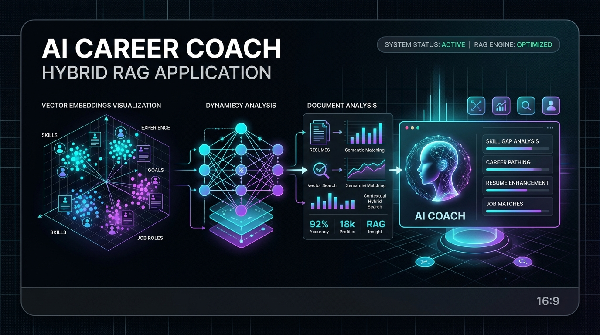
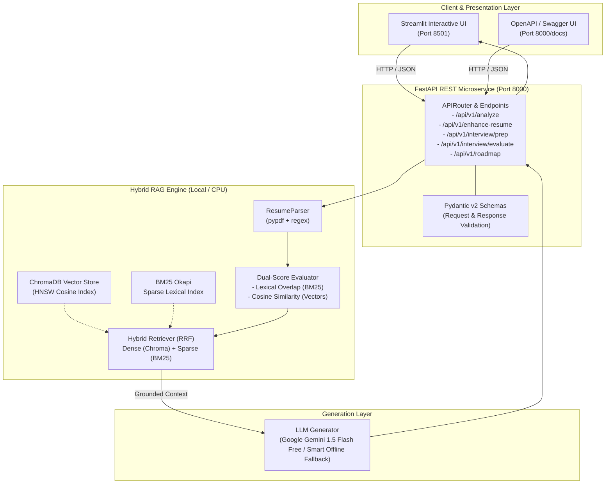

# 🎯 AI Career Coach & Interview Copilot (Hybrid RAG)

<p align="center">
  
</p>

[](https://www.python.org/)
[](https://fastapi.tiangolo.com/)
[](https://www.docker.com/)
[](https://streamlit.io/)
[](https://www.trychroma.com/)
[](LICENSE)
[]()

> A production-grade **Retrieval-Augmented Generation (RAG)** microservice application designed for career transition analysis and technical interview preparation. Combines **Dense Vector Embeddings** with **BM25 Lexical Keyword Search** via **Reciprocal Rank Fusion (RRF)**, served via a **FastAPI** REST microservice and containerized with **Docker & Docker Compose**.

---

## 🌟 Key Features

1. **Multi-Modal Document Parsing**:
   - Parses native PDF and plaintext resumes with automated section segmentation (Skills, Experience, Projects, Education).
2. **Production FastAPI REST Microservice Layer**:
   - Full OpenAPI / Swagger documentation (`/docs`) with Pydantic v2 schema validation across all endpoints.
   - Decoupled client-server architecture enabling independent scaling of inference workloads.
3. **Containerized Deployment (Docker & Docker Compose)**:
   - Multi-container orchestration spinning up the FastAPI backend and Streamlit frontend with a single command (`docker-compose up --build`).
4. **Hybrid RAG Retrieval Engine**:
   - Merges **Dense Vector Semantic Search** (`sentence-transformers/all-MiniLM-L6-v2` running locally on CPU) with **BM25 Okapi Sparse Search** for exact technical keywords.
   - Combines rankings using **Reciprocal Rank Fusion (RRF)** to eliminate false negatives.
5. **Dual-Metric Fit Evaluation**:
   - Calculates both exact lexical keyword overlap (ATS style) and deep semantic conceptual alignment (vector cosine similarity).
6. **STAR Method Resume Optimizer**:
   - Grounded in industry best practices, automatically converts task-oriented bullet points into quantified accomplishments (*Google XYZ Formula: Accomplished X, measured by Y, by doing Z*).
7. **Targeted Technical Interview Simulator**:
   - Dynamically pulls vetted technical interview questions targeting candidate skill gaps, paired with an interactive rubric-based answer grader.
8. **Personalized 4-Week Career Roadmap**:
   - Generates a project-driven curriculum prioritizing GitHub portfolio builds and weekly interview checkpoints.
9. **100% Free & Zero-Credit-Card Architecture**:
   - Runs locally out-of-the-box. Uses Google Gemini's free tier (no credit card needed) and local CPU embeddings/vector store with offline smart heuristics fallback.

---

## 🏗️ System Architecture



---

## 🛠️ Technology Stack

| Layer | Technology | Rationale & Trade-offs |
|---|---|---|
| **API Backend** | FastAPI & Uvicorn | High-performance asynchronous REST API, automatic OpenAPI / Swagger generation, Pydantic type safety |
| **Containerization**| Docker & Docker Compose | Containerized isolation, multi-service orchestration, zero-configuration deployment across platforms |
| **Frontend UI** | Streamlit | Rapid prototyping, interactive stateful dashboards, dual-mode API/local execution |
| **Embeddings** | `sentence-transformers` (`all-MiniLM-L6-v2`) | Runs 100% locally on CPU, 384 dimensions, zero API cost, sub-15ms latency |
| **Vector Database** | ChromaDB | Lightweight, persistent SQLite-backed vector storage with HNSW graph indexing |
| **Sparse Retrieval** | `rank-bm25` (Okapi BM25) | Critical for exact technical keyword matching (e.g. `Docker`, `PyTorch`, `FastAPI`, `CUDA`) |
| **Rank Merging** | Reciprocal Rank Fusion (RRF) | Balances different score distributions between cosine similarity and BM25 scores |
| **LLM Provider** | Google Gemini 1.5 Flash | 100% free tier at Google AI Studio with **NO credit card required**, fast TTFT |

---

## 🚀 Quick Start Guide

### Option A: Run with Docker Compose (Recommended)
Ensure you have [Docker Desktop](https://www.docker.com/products/docker-desktop/) installed.

```bash
# Clone the repository
git clone https://github.com/SeifMohamed19/ai-career-coach-rag.git
cd ai-career-coach-rag

# Spin up both FastAPI Backend (8000) and Streamlit Frontend (8501)
docker-compose up --build
```
- Open the **Streamlit Web UI**: `http://localhost:8501`
- Open the **Interactive Swagger API Docs**: `http://localhost:8000/docs`

---

### Option B: Local Python Setup

#### 1. Set Up Virtual Environment
```bash
# Create and activate a virtual environment
python -m venv venv
# On Windows:
.\venv\Scripts\activate
# On Linux/macOS:
source venv/bin/activate

# Install dependencies
pip install -r requirements.txt
```

#### 2. Configure Environment (Optional Free API Key)
Copy `.env.example` to `.env`:
```bash
copy .env.example .env
```
*(Note: If you leave the key blank, the application will automatically run in **Smart Offline Heuristic Mode**, allowing complete testing without internet or keys).*

#### 3. Run FastAPI Backend (Terminal 1)
```bash
uvicorn src.api.main:app --host 0.0.0.0 --port 8000 --reload
```
Interactive API docs available at `http://localhost:8000/docs`.

#### 4. Run Streamlit Frontend (Terminal 2)
```bash
streamlit run app.py
```
Open `http://localhost:8501` in your browser. Click **"🚀 Load Sample Profile & Job"** in the sidebar to test immediately with one click!

---

## 📡 REST API Specification

| Method | Endpoint | Description |
|---|---|---|
| `GET` | `/health` | Healthcheck returning service status & indexed ChromaDB document count |
| `POST` | `/api/v1/analyze` | Computes dual-score fit (BM25 + vector cosine) and extracts missing skill gaps |
| `POST` | `/api/v1/enhance-resume` | Rewrites raw experience bullets using retrieved STAR impact patterns |
| `POST` | `/api/v1/interview/prep` | Retrieves targeted technical interview questions matching identified gaps |
| `POST` | `/api/v1/interview/evaluate` | Evaluates candidate answer and provides score (out of 10) with feedback |
| `POST` | `/api/v1/roadmap` | Generates a 4-week step-by-step career transition curriculum |

---

## 🎓 Technical Interview Defense Guide

### Q1: *"Why decouple the architecture into a FastAPI backend and Streamlit frontend instead of running everything inside Streamlit?"*
> **Answer**:  
> "Running ML pipelines directly inside a Streamlit script creates significant bottlenecks: Streamlit re-executes the Python file on every user interaction, causing redundant state management and tying inference concurrency to the UI thread.  
> By decoupling the system into a **FastAPI microservice**, we achieve:  
> 1. **Independent Scalability**: The backend can be containerized, load-balanced, and scaled across worker processes (Gunicorn/Uvicorn) independently of the UI.  
> 2. **Multi-Client Support**: The same RAG backend can serve web frontends, mobile apps, or CI/CD pipelines via standardized REST endpoints.  
> 3. **Type Safety & Contracts**: Pydantic v2 enforces strict payload validation with automatic OpenAPI/Swagger documentation."

### Q2: *"Why containerize the RAG application using Docker and Docker Compose?"*
> **Answer**:  
> "ML applications frequently face the *'works on my machine'* problem due to complex C++ dependencies (ChromaDB SQLite binaries, PyTorch CPU wheels, ONNX runtime).  
> Containerizing with Docker encapsulates the exact Python 3.10 runtime, OS-level dependencies, and vector store configurations into an immutable image. Docker Compose orchestrates the multi-container topology (FastAPI on 8000, Streamlit on 8501) with internal DNS resolution and persistent volume mounts for vector storage."

### Q3: *"Why use RAG for career coaching when a resume and job description easily fit in an LLM context window?"*
> **Answer**:  
> "A simple prompt with just a resume and job description is a closed-world comparison. The LLM has no external benchmark of industry standards and often hallucinates arbitrary advice.  
> In our system, RAG grounds the analysis in an external curated knowledge base:  
> 1. Real industry competency standards (separating must-haves from nice-to-haves).  
> 2. A verified bank of real technical interview questions indexed by topic.  
> 3. Standardized STAR impact heuristics.  
> This ensures domain-calibrated, verifiable feedback rather than generic opinions."

---

## 📂 Project Structure

```
RAGProject/
├── app.py                         # Streamlit web dashboard (dual-mode client)
├── Dockerfile                     # Multi-stage container definition
├── docker-compose.yml             # Multi-service orchestration (API + UI)
├── .dockerignore                  # Container build excludes
├── test_api.py                    # Automated FastAPI endpoint test suite
├── test_pipeline.py               # Automated RAG engine smoke test
├── requirements.txt               # Pinned production dependencies
├── .env.example                   # Environment configuration template
├── .gitignore                     # Version control excludes
│
├── data/
│   ├── competencies/              # Industry skill taxonomies (AI, MLE, Backend)
│   ├── interview_questions/       # Real technical interview questions with rubrics
│   ├── resume_patterns/          # Google XYZ & STAR formulation rules
│   └── chroma_db/                 # Persistent vector database storage
│
├── samples/
│   ├── sample_resume.txt          # Pre-loaded sample candidate resume
│   └── sample_job_description.txt # Pre-loaded target AI Engineer job posting
│
└── src/
    ├── config.py                  # Central configuration & hyperparameters
    ├── api/                       # Production FastAPI REST Microservice
    │   ├── __init__.py
    │   ├── main.py                # FastAPI entrypoint, CORS & OpenAPI config
    │   ├── routes.py              # REST endpoints & dependency injection
    │   └── schemas.py             # Pydantic v2 request/response models
    ├── parsers/
    │   └── resume_parser.py       # PDF & text extraction and segmentation
    ├── rag/
    │   ├── embeddings.py          # Local Sentence-Transformers CPU wrapper
    │   ├── vector_store.py        # ChromaDB persistent collection manager
    │   ├── hybrid_retriever.py    # Hybrid BM25 + Dense RRF retriever
    │   └── knowledge_base.py      # Ingestion engine for domain documents
    ├── services/
    │   ├── analyzer_service.py    # Skill gap analysis & dual-metric scoring
    │   ├── resume_enhancer.py     # STAR bullet point rewriter
    │   ├── interview_service.py   # Mock interview generator & answer grader
    │   └── roadmap_service.py     # 4-week personalized curriculum generator
    └── utils/
        └── logger.py              # Standardized logging
```

---

## 📜 License
MIT License. Feel free to use and adapt this project for your portfolio!
